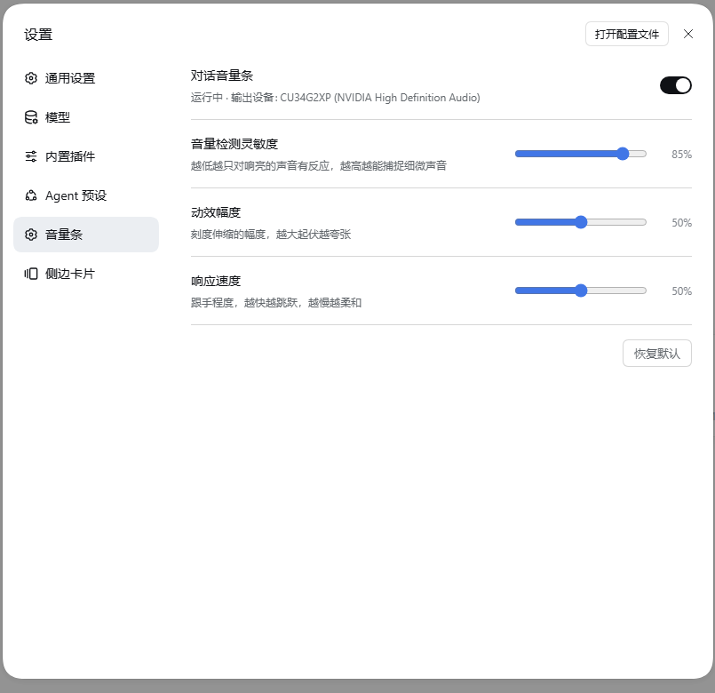
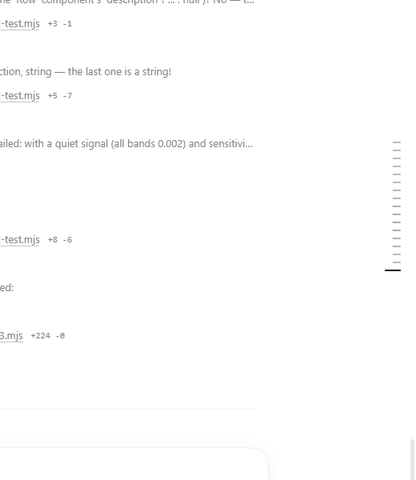

# dsh-volume-bar · 对话音量条

把 DSH 对话右侧那条**轮次导航栏（turn rail）**变成跟着音乐跳动的音量条。

抓的是 **Windows 系统输出音频**（WASAPI loopback，即"扬声器里正在放什么"），不是麦克风——所以你放歌、看视频、听播客，它就跳；你不放，它就安静。

> **English** — A DSH plugin that turns the conversation turn rail into a music-reactive
> volume bar. It taps the Windows system output (WASAPI loopback, not the microphone) and
> drives each rail tick from one frequency band. Settings live in their own page
> (`Settings → Volume bar`) with a switch, sensitivity, amplitude and response-speed knobs.
> Windows only. MIT licensed.
>
> ```powershell
> dsh plugin --profile desktop add "dsh-volume-bar-0.4.0.tgz"
> ```

| | |
|---|---|
| **平台** | Windows（WASAPI loopback；macOS / Linux 需要另写音频后端） |
| **依赖** | 无。首次打开开关时自动建 venv 并 `pip install pyaudiowpatch`（用 DSH 自带 Python） |
| **实测版本** | DSH 0.2.0-rc.2 桌面端，`desktop` profile |
| **协议** | MIT |

## 它长什么样

**设置里单开了一栏**：`设置 → 音量条`（和「通用设置」「模型」并列在左侧栏）。



页面上四行：

| 行 | 作用 | 默认 |
|---|---|---|
| **对话音量条** | 总开关，右边显示实时状态与抓到的输出设备 | 关 |
| **音量检测灵敏度** | 噪声门。越低越只对响亮的声音有反应，越高越能捕捉细微声音 | 50% |
| **动效幅度** | 刻度伸缩的幅度。越大静止时越短、起伏越夸张 | 50% |
| **响应速度** | 跟手程度。同时影响包络平滑与参考电平的释放快慢 | 50% |
| **恢复默认** | 把上面三个旋钮拨回 50% | — |

打开后，导航栏每一轮一个刻度，**每个刻度由一段频段驱动**：低频在下面、高频在上面，长度随能量伸缩、深浅跟着变。



- **导航栏原本的动效全部保留**：当前轮次那条始终是满宽 + 最深色（"我在哪"不会丢），鼠标悬停某条时它照样放大到满宽（约 140ms 的缓动）并弹出该轮的预览卡片，键盘 focus 也照旧。
- 静音时刻度停在 0.5 倍宽度（导航栏自己的默认是 0.6），所以没放音乐时它看起来仍然是原来那条导航栏。
- **所有设置都会记住**（localStorage）：开关、三个旋钮、下次打开 DSH 自动接着跑。
- **新对话什么都不画**：会话还没有任何轮次时导航栏是空的，插件不会自己在页面上摆一条音量条——它是挂在导航栏上的小彩蛋，不是一层覆盖物。
- **跨版本不会变砖**：如果某个 DSH 版本没有 `settings.section` 可挂，插件会自动退化成一个角落小按钮，而不是完全没法开启。

### 三个旋钮背后是什么

| 旋钮 | 0% | 50%（默认） | 100% |
|---|---|---|---|
| 灵敏度 → 噪声门 | -30 dB（只认响的） | -50 dB | -70 dB（很细的声音也认） |
| 幅度 → 静止长度 | 0.75（起伏含蓄） | 0.50 | 0.25（起伏夸张） |
| 速度 → 包络攻击/释放 | 0.15 / 0.03（柔和） | 0.50 / 0.09 | 0.85 / 0.15（跳跃） |

改灵敏度时会顺手丢掉旧的参考电平，所以拖动滑块是**立刻生效**的，不用等它慢慢回落。

## 安装

```powershell
# 1) 打包（在插件目录里）
node "$env:USERPROFILE\.dsh\dsh-runtimes\dsh-primary-runtime\dependencies\pnpm\bin\pnpm.mjs" pack --pack-destination .

# 2) 装进 profile（注意：指向 .tgz，不要指向文件夹）
& "$env:LOCALAPPDATA\Programs\DeepSeek Harness\resources\runtime\cli\bin\dsh.cmd" plugin --profile desktop add ".\dsh-volume-bar-0.1.0.tgz"
```

装完**重启 DSH**，然后到 `设置 → 音量条` 里把开关打开。

> 实测细节：**首次** `add` 会把包名加进 profile 的 `dsh.profile.bundles`，这会触发一次热重载，宿主半当场就挂上了（`/volume-bar/state` 立刻有响应）。
> 但**升级版本**（同一个包名再 `add` 一次）不会改变 bundles 列表，因此宿主半**不会热重载**——新代码要等下一次重启 DSH 才生效。浏览器半不受影响，刷新页面即可拿到新 bundle。

## 首次使用会自动装依赖

音频助手是一个 Python 小脚本，需要 `pyaudiowpatch`（带 WASAPI loopback 的 PortAudio 封装）。第一次点 ♪ 时宿主半会自动：

1. 在 `~/.dsh/tools/dsh-volume-bar/venv` 建一个 venv（继承 DSH 自带 Python 的 `--system-site-packages`，所以 numpy 直接可用）；
2. `pip install pyaudiowpatch`。

需要联网，大约几十秒。之后就不再需要了。想手动准备：

```powershell
& "$env:USERPROFILE\.dsh\tools\dsh-volume-bar\venv\Scripts\python.exe" -m pip install pyaudiowpatch
```

## 在「真实 DSH 页面」里做验证（不用碰桌面窗口）

想确认插件在**真正的 DSH 页面**里也生效（而不是只在离线预览页里），可以另开一个无头浏览器加载同一个页面。认证绕不开，但**会话 cookie 是可以自己签的**：

```js
// cookie 名 = "dsh-auth-" + base64url(sha256("127.0.0.1:19387"))
// cookie 值 = "v1." + base64url(JSON.stringify({version:1, authority, issuedAt, expiresAt}))
//            + "." + base64url(HMAC-SHA256(secret, body))
// secret 取自 $DSH_HOME/.credentials.yaml 里
//   records["client-connection/browser-session"].payload.secret（base64url，32 字节）
```

签好之后用 CDP 塞进无头 Edge（`Network.setCookie` → `Page.navigate`），就能拿到完整页面。实测结论：

```
settings nav:        ["通用设置","模型","内置插件","Agent 预设","音量条","侧边卡片"] ← 独立分栏
settings page:       rowCount 5（开关 + 灵敏度 / 幅度 / 速度 + 恢复默认）
after toggle:        对话音量条 → "运行中 · 输出设备: …"，checked: "true"
real turn rail:      markCount 17, markClass: "xpvNua_mark"
                     frameClass: "xpvNua_frame dsh-vb-on"      ← 真实导航栏被接管
                     widths: 0.500 ×16, 1.000（当前轮次）
hover:               width 0.502 → 1.000（放大）→ 移开后 0.502
new conversation:    页面上不新增任何元素（没有兜底音量条）
```

顺带一个坑：**无头 Chrome/Edge 没有真实音频输出**（`AudioContext` 播放不会进入系统混音器），所以「放音乐看它跳」这一步在无头环境里做不了，只能在真机上看。

## 离线预览（不用打开 DSH）

[`dev/demo.html`](dev/demo.html) 用 DSH **真实的类名**（`xpvNua_frame / _marks / _mark`）搭了一条假导航栏，然后加载**真正的 `lib/client.js`**，用合成电平驱动它。直接双击用浏览器打开即可：

- 默认：合成电平（低频最响），用来确认「插件能不能找到并驱动这条导航栏」；
- `?host=1`：改成读**真实的系统音量**（需要 DSH 在跑，`/volume-bar/*` 路由是公开的）；
- `?static=1,.8,.6,.45,.3,.2,.1,0`：固定 8 个频段值，用来做确定性渲染检查；
- `?auto=1`：自动点一下 ♪；
- `?raf=timer`：把 `requestAnimationFrame` 换成定时器。

最后那个参数是为**无头浏览器**准备的：`--dump-dom` / `--screenshot` 模式下不产出帧，rAF 不会回调，动画循环就停住了。用它可以让循环在虚拟时间里照常推进：

```powershell
& "$env:ProgramFiles(x86)\Microsoft\Edge\Application\msedge.exe" --headless=new --disable-gpu `
  --user-data-dir="$env:TEMP\dsb-edge" --virtual-time-budget=6000 --window-size=900,620 `
  --screenshot="$env:TEMP\demo.png" `
  "file:///<插件目录>/dev/demo.html?auto=1&raf=timer&static=1,0.8,0.6,0.45,0.3,0.2,0.1,0"
```

实测渲染出来的刻度宽度（右对齐、低频在底部）：

```
3px  3px  7px  10px  13px  15px  18px  20px
```

对应 `--dsh-vb-w` 的 0.16 / 0.16 / 0.359 / 0.484 / 0.626 / 0.744 / 0.880 / 1.000。

> 这个无头检查抓到过一个真 bug：`background: var(--dsh-vb-color, var(--dsw-alias-label-primary))` 里两个变量都没定义时，CSS 会在「计算值阶段」判为非法 → `background` 变成透明 → **刻度整条看不见**。现在补了字面量兜底 `var(--dsw-alias-label-primary, #111)`。

## 自检脚本

不想靠肉眼判断「到底哪一环坏了」时，跑这个（**必须用 Windows PowerShell 跑，脚本带 UTF-8 BOM**）：

```powershell
powershell -ExecutionPolicy Bypass -File verify.ps1          # 静默自检
powershell -ExecutionPolicy Bypass -File verify.ps1 -Tone    # 顺带放 3 秒测试音，验证真能抓到信号
```

它会依次报告：

1. **profile 安装状态** —— 包装了没、在不在 `dsh.profile.bundles` 里；
2. **宿主半** —— `/volume-bar/state` 是否响应、浏览器半有没有上报；
3. **音频助手** —— venv 在不在、抓到哪个设备、收到多少帧电平；
4. `-Tone` 时额外报告**抓到的最大 rms 和频段向量**（能抓到真实信号才算通）。

实测输出长这样：

```
== 1. profile 安装状态
   ok   已安装 dsh-volume-bar 0.1.3
   ok   已在 dsh.profile.bundles 中
== 2. 宿主半（HTTP 路由）
   ok   宿主半在线；依赖就绪 = True
== 3. 音频助手
   ok   venv 存在：...\.dsh\tools\dsh-volume-bar\venv\Scripts\python.exe
   ok   抓到设备：CU34G2XP (NVIDIA High Definition Audio)
   ok   收到 60 帧电平数据
结论：这条链路是通的。
```

## 结构

| 文件 | 作用 |
|---|---|
| `lib/index.js` | 宿主半：管理音频助手进程，在 DSH webserver 上挂 `/volume-bar/*` 路由 |
| `lib/audio-levels.py` | 音频助手：抓默认输出设备的 loopback，每 ~33ms 输出一行 JSON（RMS + 8 个频段） |
| `lib/client.js` | 浏览器半：找到轮次导航栏的刻度，按频段驱动它们的长度与透明度；提供 ♪ 开关 |
| `cordis.patch.yml` | 挂载行（id `volume-bar`） |

## HTTP 接口

| 方法 | 路径 | 说明 |
|---|---|---|
| GET | `/volume-bar/state` | 就绪状态、运行状态、设备、安装日志、浏览器半是否已上线 |
| GET | `/volume-bar/levels` | 最新一帧电平（客户端 ~22Hz 轮询） |
| POST | `/volume-bar/hello` | 浏览器半加载时打的一次性信标（带找到的刻度数量） |
| POST | `/volume-bar/start` | 启动（未装依赖时自动先装） |
| POST | `/volume-bar/stop` | 停止 |
| POST | `/volume-bar/setup` | 只做依赖安装 |

客户端超过 60 秒不轮询，宿主会自动停掉音频进程，避免后台常驻。

## 已知限制与注意

- **只支持 Windows**（WASAPI loopback）。macOS / Linux 需要另写音频后端。
- 路由只监听回环地址，但**没有鉴权**——本机其它进程也能调用 `/volume-bar/*`。个人插件，按需接受。
- 频段→刻度的映射靠 CSS 类名里的 `_mark` / `_frame` 片段定位（DSH 客户端 bundle 的类名带哈希前缀）。DSH 大改这块 DOM 时可能失效，届时看控制台有没有 `dsh-volume-bar` 开头的日志。
- 电平做的是**自适应增益**（AGC）：系统音量很小也能跳起来，代价是绝对音量信息不可读。

## 卸载

```powershell
& "$env:LOCALAPPDATA\Programs\DeepSeek Harness\resources\runtime\cli\bin\dsh.cmd" plugin --profile desktop remove dsh-volume-bar
```

再重启 DSH。`~/.dsh/tools/dsh-volume-bar` 里的 venv 可以手动删。
